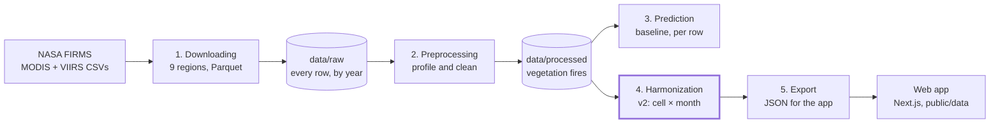
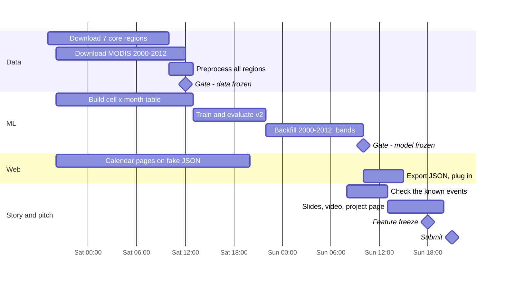

# FireBridge: Full Project Plan

As of Nov 13, 2026 · NASA Space Apps 2026 · *Harmonization of MODIS and VIIRS Hot Spots*

> This file is the team's working plan. Edit it in pull requests or directly on `main`; tick the checkboxes as things land.

## Goal

FireBridge turns 25 years of fire records from two NASA sensors into one consistent burning-activity calendar, so a rise in fires means real fires, not a sensor switch.

**The pitch in one sentence:** MODIS (2000+) and VIIRS (2012+) see fires differently, so joining them creates a fake jump in 2012; we learn the difference from 12 years where both overlap, rebuild the pre-2012 record on the VIIRS scale, and show it as a calendar for 7 regions with very different fire types.

**What we hand in by the deadline:**

1. A working web dashboard (the Next.js app in this repo): the harmonized calendar per region, with uncertainty.
2. Five notebooks in `notebooks/` that reproduce every number.
3. A 30-second demo video with English subtitles (or up to 7 slides).
4. The Space Apps project page.

## Where we are

The data pipeline and the per-detection baseline work end to end; the baseline's main lesson is that it can't be the final model.

| Piece | Status | Result |
| --- | --- | --- |
| 1. Downloading notebook | Done | 9 study regions from the team plan, 2013–2024, Parquet on Drive |
| 2. Preprocessing notebook | Done | Profiling, EDA plots, cleaning (vegetation fires only) |
| 3. Prediction notebook (per MODIS detection) | Done, tested on Egypt + Portugal | XGBoost beats the average ratio (deviance 1.62 vs 2.78), final test bias −5% |
| 4. Harmonization notebook (version 2) | Ran on Colab for all 7 regions (see [first full run](#first-full-colab-run-14-nov)); earlier test on Egypt + Portugal | Test 2022–2024: total bias −0.5%, monthly WAPE 26% (ratio: −9%, 31%); 2012 jump 9.4× → 1.14× in the Delta. See [Version 2 results](#version-2-results-so-far) |
| Naive baseline write-up | Done | [`docs/naive-baseline.md`](naive-baseline.md) |
| 5. Export notebook | Done | JSON for the app in `public/data/` |
| Web app | Calendar page on real data; other pages still demo | `/dashboard/calendar`: calendar, yearly chart, 2012 check, scores, anomalies |

**What the baseline taught us:**

- **Blind spot.** Most VIIRS detections fall where no MODIS pixel saw anything: 88% in the Nile Delta, 25% in Portugal. A model that converts MODIS detections one by one can never add those fires back.
- **Fire type matters.** Trained on Portugal, the model overpredicts Egypt by 84%; trained on Egypt, it underpredicts Portugal by 71%.
- **Terra.** The per-detection model only fits Aqua, but before mid-2002 only Terra exists.

All three point to the same fix: model **totals per area and month**, using every MODIS detection (Terra and Aqua) as input. That is version 2.

## Architecture

Five notebooks pass data through Google Drive folders, and the web app reads only the small files the last notebook exports.

Notebooks 1–3 are done. Notebook 4 (version 2) and notebook 5 (export) are new; notebook 3 stays as the documented baseline.

## Version 2: harmonize totals per grid cell and month

The main model predicts how many VIIRS detections a 10 km grid cell would have had in a month, from everything MODIS saw there and around it. It goes in a new notebook, **4. Harmonization**.

**Unit (one row):** one 10 km × 10 km cell × one month, for **every** cell in the region's rectangle and every month 2013–2024, including cells where MODIS saw nothing. Those rows are how the model learns the blind spot. The grid is the equal-area one from the team's v1 modeling notebook (EPSG:6933).

**Target:** VIIRS detections in that cell-month.

**Features (MODIS only, Terra and Aqua together):**

| Feature | Why it helps |
| --- | --- |
| Terra count, Aqua count | The main signal; both satellites feed it, which solves the Terra problem |
| FRP sum, max, mean | Big fires spread over more VIIRS pixels |
| Mean pixel size (`scan × track`) | Edge-of-swath MODIS pixels hide small fires |
| Day share | Night detection behaves differently |
| MODIS count in the 8 neighbouring cells | Fire activity nearby that MODIS missed in this cell |
| Cell's long-term MODIS average (2000–2024) | Marks crop-burning cells vs. quiet ones; uses no VIIRS, so no leakage |
| Month (sin, cos), region | Burning season and fire type |

**Models:** the region-wide average ratio as the baseline, then XGBoost and HistGB with a Poisson (or Tweedie) loss. Most rows are zero, which both losses handle.

**Evaluation:** the same split as notebook 3 (train ≤ 2020, validation 2021, test 2022–2024), scored on **monthly totals per region** (bias % and WAPE %), plus leave-one-region-out.

**Backfill:** apply the model to 2000–2012. This needs MODIS for those years, which the plan's 2013–2024 range doesn't cover: `downloadRegions(years=range(2000, 2013), sensors=('modis',))`.

**Uncertainty:** train 5 models with different seeds and data resamples; the spread becomes the band shown on the dashboard.

**Output:** one table, region × cell × month 2000–2024: raw MODIS, real VIIRS (2012+), harmonized value, low/high band.

### Version 2 results so far

Full write-ups: [project report (PDF)](FireBridge_Project_Report.pdf) · [version 2 models (PDF)](FireBridge_V2_Models.pdf).

Tested on Egypt Nile Delta + Portugal Centro (MODIS 2000–2024, VIIRS 2013–2024, 607 cells, 182,100 cell-months). Notebook: [`notebooks/4_Harmonization.ipynb`](../notebooks/4_Harmonization.ipynb).

**Main model: the ratio × a learned correction.** XGBoost (Poisson loss) starts from the per-region ratio (and, where MODIS saw nothing, that region's typical VIIRS count) and learns how much to scale it. Plain gradient boosting fit cells well but underestimated the biggest fire months, because trees can't predict beyond what they saw.

| Test years 2022–2024 | Cell deviance | Total bias | Monthly WAPE | Monthly corr |
| --- | --- | --- | --- | --- |
| Average ratio (per region) | 7.26 | −9.1% | 31.1% | 0.961 |
| Plain gradient boosting | 0.99 | −3.9% | 30.4% | 0.960 |
| **Ratio × learned correction** | **0.96** | **−0.5%** | **26.0%** | **0.977** |

**The 2012 check (2013–15 vs 2009–11):**

| Region | Raw jump (MODIS → VIIRS) | Real change (MODIS only) | Harmonized jump |
| --- | --- | --- | --- |
| Egypt Nile Delta | 9.38× | 1.20× | 1.14× |
| Portugal Centro | 1.99× | 0.75× | 0.87× |

**Known events:** Portugal's Jun and Oct 2017 fires are the two top anomalies (z = 29.7 and 22.9).

**Not solved yet:** leave-one-region-out is poor (Egypt −84%, Portugal +80% bias). Two regions with opposite fire types can't teach a new one; this should improve with all 7 regions. The ensemble band shows model uncertainty only, so it is narrower than the real error.

### First full Colab run (14 Nov)

Executed notebooks are kept as a record in [`notebooks/colab_runs/2026-11-14/`](../notebooks/colab_runs/2026-11-14/); the clean source notebooks stay in `notebooks/`.

**2012 jump check (2011 → 2013 change):** the harmonized series lands close to the real VIIRS-era change in every region.

| Region | Raw MODIS→VIIRS | Real (VIIRS-scale) | Harmonized |
| --- | --- | --- | --- |
| Australia NSW | 5.28× | 1.08× | 1.26× |
| Brazil North Pantanal | 1.97× | 0.52× | 0.48× |
| Canada NWT (south) | 204.8× | 31.1× | 37.0× |
| Egypt Nile Delta | 9.38× | 1.20× | 1.16× |
| Guinea Kankan & Siguiri | 4.00× | 0.98× | 0.97× |
| Indonesia Central Kalimantan | 8.74× | 1.78× | 1.87× |
| Portugal Centro | 1.99× | 0.75× | 0.81× |

**Known events found as top anomalies:** NSW Nov & Dec 2019 (z 29.6, 18.5), Pantanal 2020, Canada Sep & May 2023 (z 34.6, 13.9), Portugal Jun & Oct 2017 (z 26.8, 22.1).

**Test 2022–2024 by region (main model):** total bias NSW −7.4%, Pantanal −1.0%, Canada +10.6%, Delta −8.8%, Guinea −3.6%, Indonesia +16.7%, Portugal −12.6%; monthly WAPE 7.6–19.6%, except Portugal 38%. Overall: main +4.9% bias / 11.9% WAPE, ratio +4.8% / 11.6%, correlation 0.99; per cell the main model is far better (deviance 1.42 vs 6.07).

**Caveats, to fix in the rerun:**

- This run used the **older notebook 4** (before the region-name fix and `report.json`), so the region features were all zero and the app has no test scores yet.
- It also trained on **whole countries** (Australia, Brazil, Egypt, Greece, Turkey) that contain the study regions. That double-counts fires and leaks each held-out region into leave-one-region-out, so the LORO numbers from this run (e.g. Delta −59%, Portugal +45%) aren't trustworthy. Notebook 4 now uses only the study regions by default.
- On totals for large regions the ratio baseline is as good as the main model; the main model's advantage is per cell and per month, which is what the map and calendar show.

## Validation: do the known fire events show up?

Beyond test-set scores, each region's documented event from the dataset plan is a check the judges can see: on the harmonized calendar, the focus period should stand out against that region's normal months, and the 2012 sensor switch should not.

| Region | Known event | Check |
| --- | --- | --- |
| Portugal Centro | Jun & Oct 2017 wildfires | Two spikes in 2017, far above the 2013–2024 baseline |
| Canada NWT (south) | May–Sep 2023 record season | 2023 is the highest year on record |
| Australia NSW | Oct 2019–Feb 2020 bushfires | One season spanning two calendar years |
| Brazil North Pantanal | Jul–Oct 2020 dry-season fires | 2020 dry season well above normal |
| Indonesia Central Kalimantan | Aug–Oct 2015 peat fires (El Niño) | 2015 the extreme year |
| Egypt Nile Delta | Sep–Nov every year; Oct–Nov 2014 case | Same autumn peak every year, 2014 visible |
| Guinea Kankan & Siguiri | Dec–May every year | A steady seasonal cycle, no single spike |

**How to score it:** for each region, compute each month's anomaly (z-score) against the same month in the other years, **leaving the event year out of the baseline**, as the plan's notes require. The event months should score highest.

**The 2012 check:** in every region, the harmonized line should continue smoothly from 2011 to 2013, while the raw MODIS + VIIRS line jumps. This is the headline chart.

## Dashboard: the burning-activity calendar in our Next.js app

We build on the web app already in this repo instead of a new site. Two changes keep it on the challenge and within the deadline.

**1. Point it at the challenge.** The app is currently framed as wildfire monitoring and risk forecasting (`/dashboard/predictions`: probability of elevated fire activity, precision/recall). The challenge asks for harmonized records and a burning-activity calendar, so:

- [x] Add **`/dashboard/calendar`** (the main view): months across, years 2000–2024 down, colour = harmonized fire activity. A toggle switches to raw MODIS or raw VIIRS so people see the 2012 jump disappear.
- [x] Add a **yearly line**: raw MODIS, real VIIRS and harmonized with its uncertainty band, the 2012 switch marked (on the Calendar page, with the 2012 jump check cards, test scores and anomalies).
- [ ] Turn **Predictions** into **Harmonization**: model comparison table (Poisson deviance, bias %, WAPE %), blind spot per region, leave-one-region-out. Replace the precision/recall/ROC-AUC cards; those are classification metrics and don't fit a count model.
- [ ] **Anomalies**: the months that stand out, with each region's known event highlighted.
- [ ] Swap the 8 demo regions for our 7 core regions (bbox, fire type, event dates) and update the landing page and About text to the harmonization story.

**2. No backend: static JSON.** A FastAPI server is one more thing to deploy and keep alive by Sunday. Notebook 5 writes JSON into `public/data/`, and [`src/lib/harmonized.ts`](../src/lib/harmonized.ts) loads it. The Calendar page always reads these real files; the older demo pages are unchanged until we move them over. Deploy on Vercel (free, native Next.js).

- [x] Notebook 5 export + `src/lib/harmonized.ts` loader; `public/data/` holds real results for Egypt Nile Delta + Portugal Centro
- [ ] Re-export with all 7 regions once notebook 4 has run on them
- [ ] Map page: draw `cells/<region>/<year>.json` (harmonized vs raw) for a chosen month

**Data contract (notebook 5 writes, the app reads):**

- `public/data/regions.json`: `Region[]` plus `bbox`, `fireType`, `eventStart`, `eventEnd`
- `public/data/calendar_<regionId>.json`: one entry per month 2000–2024: `{month, modis, viirs, harmonized, low, high}`
- `public/data/model.json`: model comparison, blind spot per region, leave-one-region-out
- `public/data/cells_<regionId>_<yyyy-mm>.json`: per-cell values for the map, only for months people can pick

The web person can build these pages now on fake files in this shape and swap in the real ones on Sunday.

## Timeline

The data is frozen Saturday noon and the model Sunday 10:00, so Sunday afternoon is only for checking, the dashboard and the pitch. Times are Cairo time.

**Owners by role** (put names next to each):

- **Data:** notebooks 1–2, downloads, shared Drive folder
- **ML:** notebook 4 (v2), backfill, uncertainty
- **Web:** Next.js app pages, `static` data mode, notebook 5 export
- **Story and pitch:** validation of known events, slides, 30-second video, project page

Open question: the exact submission closing time for our local event. The plan assumes Sunday night and submits at 21:00.

## Submission checklist

The project is submitted on the Space Apps site by Sunday, Nov 15; confirm the exact closing time with our local event, and once submitted it can't be edited.

- [ ] **Demo:** a video of up to 30 seconds **with English subtitles**, or up to 7 slides in English, title slide included
- [ ] Demo hosted on YouTube, Drive or GitHub with a **public** link (it can't be uploaded to the Space Apps site)
- [ ] Project page in English: title, summary, how it works, benefits
- [ ] Link to the final project: the dashboard URL + this GitHub repo
- [ ] Which NASA data we used: FIRMS MODIS C6.1 and VIIRS S-NPP 375 m active fires
- [ ] Note on AI tools used, if the form asks
- [ ] Terms and conditions box ticked
- [ ] Submitted at least 2 hours before the deadline

**30-second video outline:** 0–5 s team + challenge · 5–12 s the fake 2012 jump · 12–22 s the harmonized calendar, Portugal 2017 lighting up · 22–30 s the blind-spot finding + the dashboard link.

Source: [Space Apps Project Submission Guide](https://www.spaceappschallenge.org/resources/project-submission-guide/)

## Risks and fallbacks

Every risk has a fallback that still leaves a complete submission; the 2-region result we already have is the floor.

| Risk | Sign | Fallback |
| --- | --- | --- |
| Big-country downloads (Canada, Brazil, Australia) too slow | Not done by Saturday 12:00 | Go with the regions finished; Egypt, Portugal, Guinea and Indonesia are enough for the story |
| Version 2 doesn't beat the per-region average ratio | Worse test bias or WAPE | Ship the ratio for the calendar, present v2 as an honest negative result |
| A known event doesn't show up | Anomaly z-score low | Check the bbox first; else report it as a limitation, don't hide it |
| Colab runtime dies | Lost session | Everything is saved to Drive and resumes; rerun from the last finished step |
| Dashboard not ready | Sunday 12:00 | Fall back to 7 slides of static charts from the notebooks |
| FIRMS server down | Downloads fail repeatedly | Use the Drive copy; one person downloads, everyone else uses a shared folder |
| Out of time | Sunday 18:00 | Freeze features, record the demo, submit |
